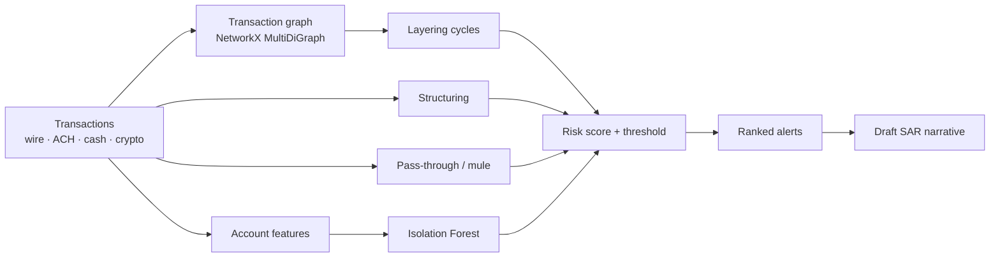

# AML Entity Graph Monitor

[](https://github.com/dawncreter/aml-entity-graph-monitor/actions/workflows/ci.yml)

Entity-centric anti-money-laundering (AML) monitoring. It builds a transaction graph, detects three classic laundering **typologies**, adds an unsupervised anomaly score, ranks accounts, and drafts a **Suspicious Activity Report (SAR)** narrative for an investigator to review.

> **Reference implementation** on synthetic data. It is inspired by my time as VP, Project Management Office at Citigroup Technologies, where I led delivery of NICE Actimize and Mantas AML case management across 100+ countries for 3,000+ investigators (see the [PMO financial controls playbook](https://github.com/dawncreter/pmo-financial-controls-playbook)). It is not Citi's code, data or detection logic.

## Why it matters
Threshold-only rules ("flag anything over $X") bury investigators in false positives and still miss schemes designed to stay under the rules. Looking at **relationships and timing** between accounts finds the patterns that matter and cuts the noise.

## Architecture


| Typology | Rule (all configurable) |
|---|---|
| **Layering cycle** | Closed loop of 3–5 accounts (A → B → C → A) where each hop happens after the previous one, inside 10 days, and keeps ≥ 80% of the previous amount |
| **Structuring** | ≥ 3 cash deposits of $8,000–$9,999 within 7 days that together exceed the $10,000 reporting threshold |
| **Pass-through** | ≥ 2 times, funds ≥ $10,000 arrive and ≥ 90% leave again within 24 hours |

**Score:** `100 · (1 − (1 − rule) · (1 − 0.3 · anomaly))`, where `rule = 1 − Π(1 − w_t)` over the typologies hit (cycle 0.6, pass-through 0.55, structuring 0.5). Accounts below 50 are suppressed.

## Demo (synthetic: 300 accounts, ~5,600 transactions, 12 planted bad actors)
```text
$ aml-monitor demo
| Account | Score | Typologies   | Truth        |
| ACC0222 | 70.2  | cycle        | cycle        |
| ACC0080 | 67.5  | pass_through | pass_through |
| ACC0172 | 61.8  | structuring  | structuring  |
…
alerts 12 · precision 1.0 · recall 1.0
baseline (any transaction ≥ $9,000): 27 alerts · precision 0.44
```
The demo then prints a draft SAR with a summary, findings and a full transaction timeline. On synthetic data the separation is clean. On real data the weights and thresholds are tuned against investigator dispositions.

## Quick start
```bash
pip install -e ".[dev]"
aml-monitor demo --accounts 500
make test        # 11 tests, ~99% branch coverage
```

## License
MIT
